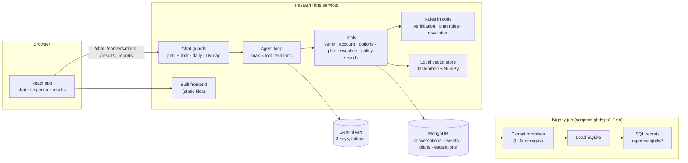

# Collections AI Agent (simulation)

> **This is a portfolio simulation.** Every lender, borrower, account, payment and conversation in it is fictional. It is not a production system, it is not a legal or regulatory compliance system, and it is not affiliated with any company.

## The problem

Loan collections is a conversation with rules attached. A borrower may want to know what they owe, set up a payment plan, dispute the debt, or ask to stop being contacted. An AI agent can handle the routine part, but only if software, not the model, decides what is allowed: who has proved their identity, which account they may see, which plans the lender permits, and when a person must take over. After the chat, someone still has to notice who promised to pay what, and by when.

This project builds that loop end to end on fictional data:

- **Chat agent.** A Gemini model talks to the borrower and asks for tools. The server verifies identity, enforces the lender's plan rules, answers policy questions from retrieved documents, and hands the conversation to a person on disputes, hardship, stop-contact requests or failed verification.
- **Evaluation.** 38 scripted multi-turn scenarios, scored by code checks with no LLM judge.
- **Extraction.** Regex and LLM extractors pull promised payments (amount and date) from finished chats, benchmarked on a held-out labelled set.
- **Nightly job.** It extracts promises from stored chats, loads them into SQLite and runs SQL follow-up and escalation reports.
- **Demo UI.** It shows the chat, the server's decisions turn by turn, and the saved results.

## Architecture



The model chooses what to say and which tool to ask for. Every tool call is validated and checked against server-side state before it runs. Refused calls return a structured error to the model and are shown in the inspector.

## Setup

Requirements: Python 3.12+, Node 24+, a MongoDB connection string, and a Gemini API key (free tier works).

```powershell
# 1. Configuration: copy the placeholders, then fill in real values in .env (never commit it).
Copy-Item .env.example .env

# 2. Backend
cd backend
python -m venv .venv
.venv\Scripts\pip install -r requirements.txt
.venv\Scripts\python -m app.db.seed            # fictional lenders, borrowers, accounts

# 3. Frontend (built once; FastAPI serves frontend/dist)
cd ..\frontend
npm install
npm run build

# 4. Run everything as one service
cd ..\backend
.venv\Scripts\python -m uvicorn app.main:app --port 8000
# open http://127.0.0.1:8000
```

For frontend development, run `npm run dev` in `frontend/` while uvicorn is running. Vite proxies the API paths to port 8000.

Demo safeguards (set in `.env`): `CHAT_REQUESTS_PER_MINUTE_PER_IP` (default 8), `LLM_DAILY_CALL_CAP` (default 200 calls per Pacific day, app-wide), and a 2,000-character message limit. When the cap is reached, `/chat` returns a friendly 429 message and the results view keeps working.

## Running the evaluation and the nightly job

```powershell
cd backend
.venv\Scripts\python -m app.evaluation.run --name latest          # about 100 Gemini calls
.venv\Scripts\python -m app.evaluation.compare_cli baseline latest
.venv\Scripts\python -m app.extraction.benchmark_cli --split test # held-out benchmark
cd ..
powershell -File scripts\nightly.ps1 -Extractor llm               # or: bash scripts/nightly.sh llm
```

Checks: `ruff check .`, `ruff format --check .` and `pytest` in `backend/`, plus `npm run typecheck`, `npm run lint` and `npm run build` in `frontend/`. Unit tests use a fake LLM and spend no quota.

## Results

All figures come from report files committed in this repo. Model: `gemini-3.5-flash-lite`.

| What | Result | Report |
|---|---|---|
| Agent evaluation, baseline | 37 of 38 scenarios passed (97.4%); 1 false escalation; 0 unauthorized actions | [`reports/evaluation/baseline.md`](reports/evaluation/baseline.md) |
| Agent evaluation, after fixes | 38 of 38 passed (100%); 0 missed and 0 false escalations; 0 unauthorized actions; 100 LLM calls | [`reports/evaluation/latest.md`](reports/evaluation/latest.md), [`comparison.md`](reports/evaluation/comparison.md) |
| Promise extraction, held-out test set (24 transcripts) | Regex: 95.8% exact match, date F1 96.8%. LLM: 95.8% exact match, date F1 100% | [`reports/extraction/test.md`](reports/extraction/test.md) |
| Nightly job, last successful run | extract, load and reports completed; project data: 1 promise, 1 escalation (dispute) | [`reports/nightly/2026-11-05_103905/`](reports/nightly/2026-11-05_103905/) |

The nightly run also writes a **simulated** report from a seeded generator (5,000 conversations, 2,000 promises). Those numbers come from the generator's own settings and only show that the SQL works at volume. They are not project results.

## Limitations

- Fictional data only, with two lenders and twelve borrowers. The evaluation set is small (38 scenarios, 52 turns) and was written by the developer, so a perfect score means "passes its own tests", not "safe in general".
- One model on a free tier. Turn latency p95 in the latest evaluation was 60.5 s (`reports/evaluation/latest.md`). It is dominated by waits from the app's own 10-requests-per-minute pacer, not model speed (Session 4 analysis in `SESSION_LOG.md`).
- Rate limiting and the daily cap are in memory and per process. A restart resets them, and several replicas would each have their own. The per-IP key is the direct peer address, so a deployment behind a proxy must configure trusted forwarded headers first.
- The daily cap is checked before each message. A turn already running may finish, so the cap can be exceeded by at most one turn's calls.
- No authentication: anyone with the URL can chat as a sample borrower. Not deployed.
- The phrase rules for escalation can over- or under-trigger. The model covers paraphrases, which the evaluation measures but cannot guarantee.
- Not built: voice, PySpark, Databricks, real payment processing, and any real compliance controls.
